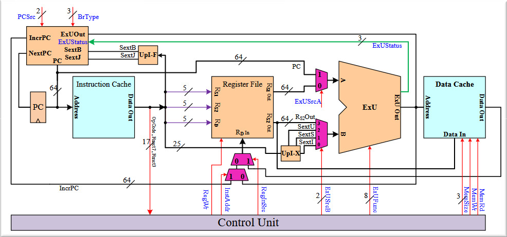
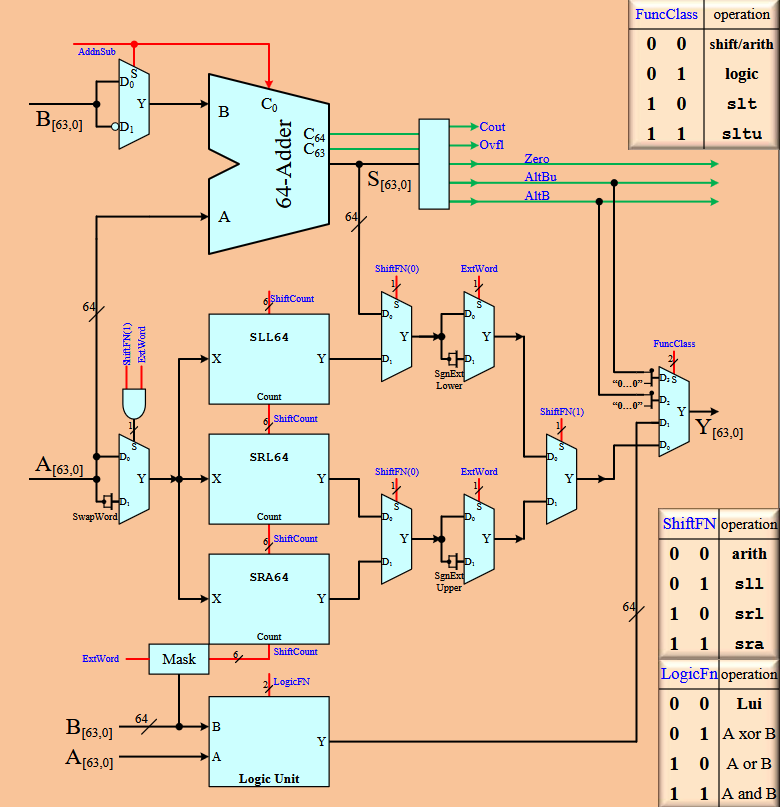

# Single-Cycle RISC-V Processor

A learning project focused on designing and implementing a single-cycle processor in VHDL using the **RISC-V RV64I instruction set**.

The goal is to understand digital logic, processor architecture, and hardware design by building the components from scratch.

## 1. Design

The processor consists of the following modules:

- **NAL** – Next Address Logic
- **PC** – Program Counter
- **CU** – Control Unit
- **ExU** – Execution Unit
- **DataMem** – Data Memory
- **IMem** – Instruction Memory

### Processor Architecture
The following diagram illustrates the complete single-cycle RISC-V processor design.

## 2. Implementation

### Execution Unit (ExU)
- Addition and subtraction using a Kogge–Stone adder
- Bitwise AND, OR, and XOR
- Signed and unsigned comparisons
- Three independent barrel shifters: SLL, SRL, and SRA
- Support for 32-bit word operations

#### Execution Unit Architecture
The following diagram illustrates the complete execution unit design.

### Control Unit (CU)
- Opcode, Funct3, and Funct7 decoders
- Instruction recognition
- Control signal generation

#### Control Unit Architecture
The following diagram illustrates the complete control unit design.

### Next Address Logic (NAL)
- Branch condition checking
- PC increment (`PC + 4`)
- Branch and jump target calculations
- Next PC selection

#### Next Address Logic Architecture
The following diagram illustrates the complete NAL design.

## 3. Test Vectors

To be continued.

## 4. References

1. [8-bit Kogge–Stone Adder – University of Cambridge](https://www.cl.cam.ac.uk/research/srg/han/ACS-P35/8-bit-KoggeStone-Adder.pdf)
