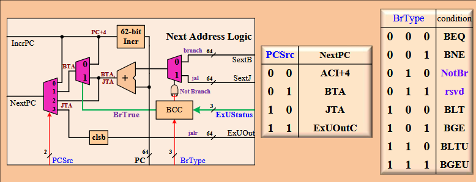

# Single-Cycle RISC-V Processor

A learning project focused on designing and implementing a single-cycle processor in VHDL using the **RISC-V RV64I instruction set**.

The goal is to understand digital logic, processor architecture, and hardware design by building the components from scratch.

## 1. Design

The processor consists of the following modules:

- **ProcessorCore** – CPU core integrating the datapath and control logic
- **PC** – Program Counter
- **NAL** – Next Address Logic
- **CU** – Control Unit
- **ExU** – Execution Unit
- **Register File** – General-purpose registers
- **Immediate Generator** – Instruction immediate extraction and sign extension
- **IMem** – Instruction Memory
- **DataMem** – Data Memory

### Processor Architecture

The following diagram illustrates the complete single-cycle RISC-V processor design.

## 2. Implementation

### Processor Core

Integrates the processor's main components and manages the connections between the datapath, control signals, and memory interfaces.

- Instruction decoding and operand routing
- Register read and write-back paths
- Execution Unit and Control Unit integration
- Instruction and data memory interfaces

#### Processor Core Architecture

*Diagram to be added.*

### Program Counter (PC)

- N-bit register storing the current instruction address
- Clock-driven PC updates
- Reset functionality
- Receives the next instruction address from NAL

#### Program Counter Architecture

*Diagram to be added.*

### Next Address Logic (NAL)

- Branch condition checking
- PC increment (`PC + 4`)
- Branch and jump target calculations
- JALR target address alignment
- Next PC selection

#### Next Address Logic Architecture

The following diagram illustrates the NAL design.

### Control Unit (CU)

- Opcode, Funct3, and Funct7 decoders
- Instruction recognition
- Control signal generation

#### Control Unit Architecture

The following diagram illustrates the Control Unit design.

### Execution Unit (ExU)

- Addition and subtraction using a Kogge–Stone adder
- Bitwise AND, OR, and XOR
- Signed and unsigned comparisons
- Three independent barrel shifters: SLL, SRL, and SRA
- Support for 32-bit word operations
- Arithmetic status flag generation

#### Execution Unit Architecture

The following diagram illustrates the Execution Unit design.

### Register File

- 32 general-purpose registers
- Two read ports and one write port
- Synchronous register writes
- Register `x0` permanently set to zero

#### Register File Architecture

*Diagram to be added.*

### Immediate Generator

- I-type immediate extraction
- S-type immediate extraction
- B-type branch offset generation
- U-type immediate generation
- J-type jump offset generation
- Sign extension to the processor's datapath width

#### Immediate Generator Architecture

*Diagram to be added.*

### Instruction Memory (IMem)

- Storage of 32-bit RISC-V instructions
- Instruction fetching using the Program Counter
- Byte-addressed instruction selection
- Program initialization

#### Instruction Memory Architecture

*Diagram to be added.*

### Data Memory (DataMem)

- Load and store operations
- Byte, halfword, word, and doubleword accesses
- Signed and unsigned load support
- Memory read/write control
- Address decoding and data alignment

#### Data Memory Architecture

*Diagram to be added.*

## 3. Test Vectors

To be continued.

## 4. References

1. [8-bit Kogge–Stone Adder – University of Cambridge](https://www.cl.cam.ac.uk/research/srg/han/ACS-P35/8-bit-KoggeStone-Adder.pdf)
2. [RISC-V Instruction Set Manual](https://docs.riscv.org/)